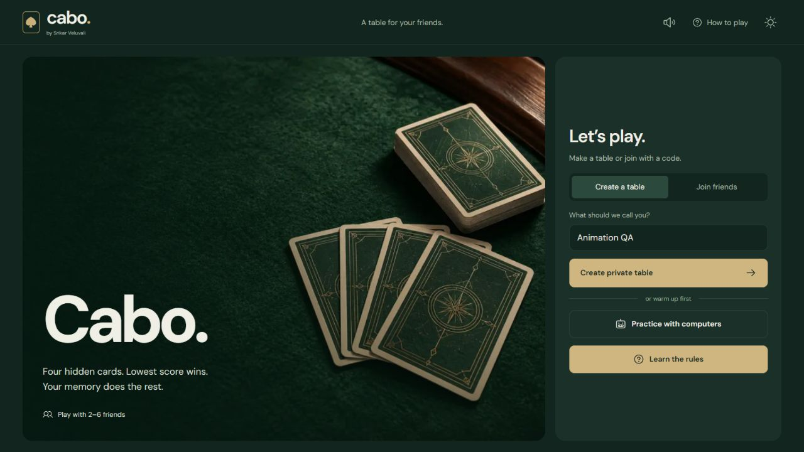
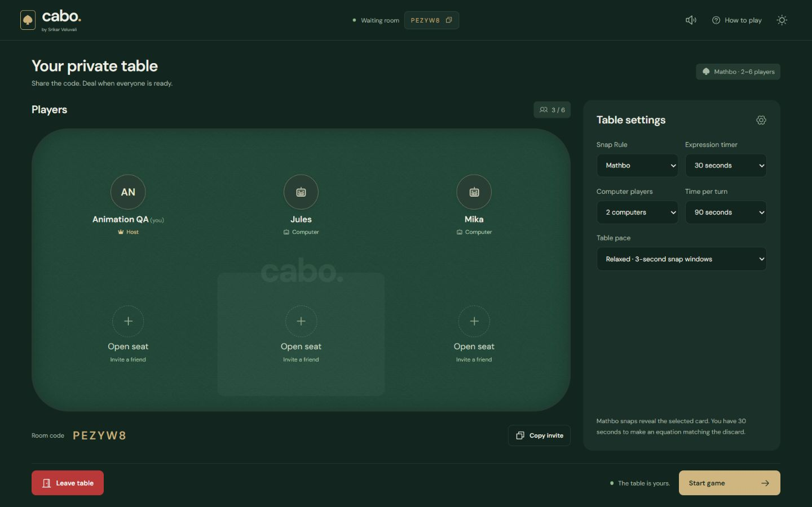
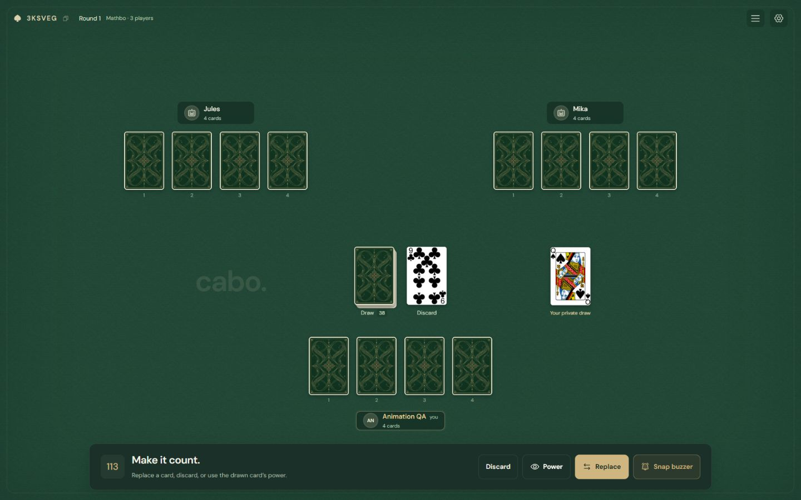
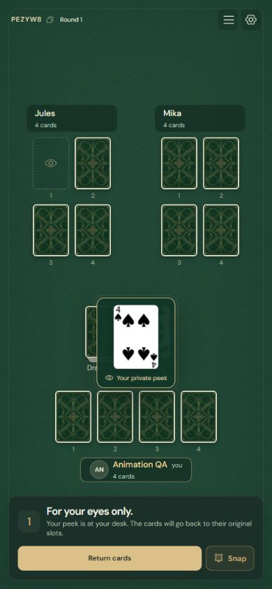
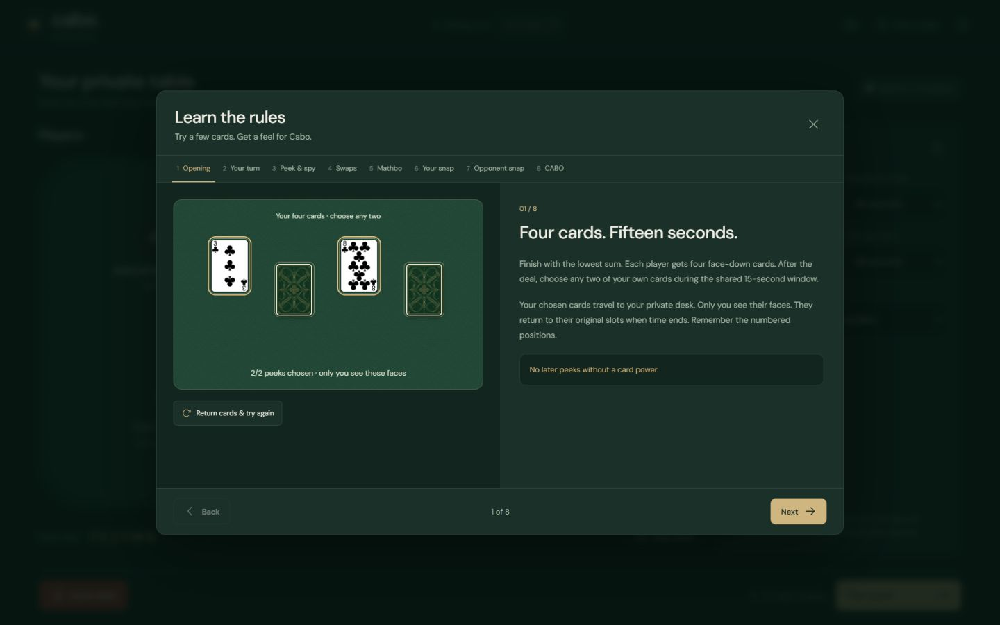
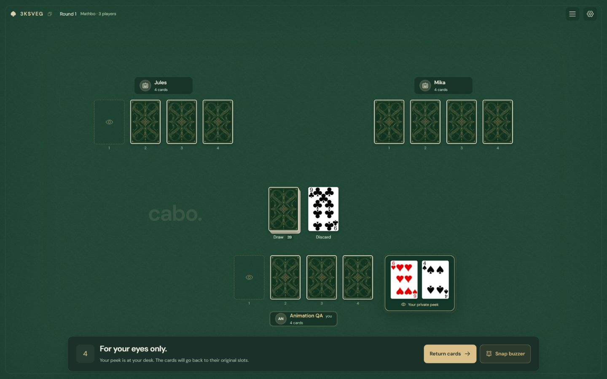
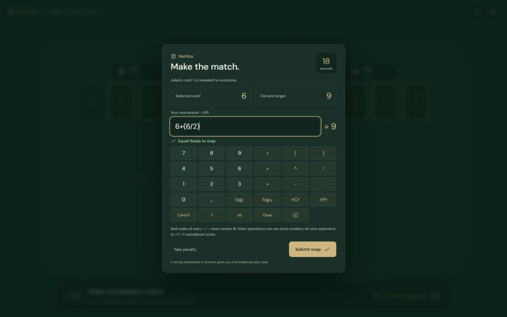
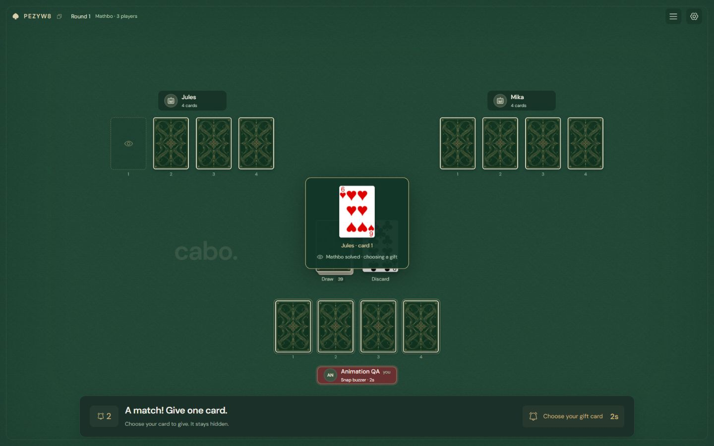

# Cabo

**Four cards. Two peeks. Trust your memory.**

A private multiplayer card game by **Srikar Veluvali**. Remember hidden cards, use powers, race the snap buzzer, and call CABO when you think your total is lowest. Play with friends or practice against computers.

[Play Cabo](https://cabo-multiplayer.vercel.app/) · [Rules](#how-to-play) · [Mathbo](#mathbo) · [Run locally](#run-locally)

The screenshots below show the current source version. The hosted link runs the last deployed release; local changes appear there after deployment.



## A table for your friends

1. Enter your name and **Create a table**, or choose **Join friends** with a six-character room code.
2. **Copy invite** to share the table. There are **2–6 seats**, including up to **three computers**. **Practice with computers** creates a table with two opponents.
3. In the waiting room, choose **Snap Rule → Matching ranks or Mathbo**, the turn timer, and table pace. Mathbo adds an expression timer.
4. Guests mark themselves ready. The host starts the game.



## Made for playing

The live table fills the screen with the cards and controls. Action notices have their own strip above the hands, leaving the piles clear. Open the scrollable **Table activity** log to follow earlier moves, or **Table options** for sound, theme, rules, and leaving.

- Cards travel visibly when drawn, replaced, discarded, swapped, snapped, or given to another player.
- Private peeks travel to the acting player's desk and return to their original numbered slots. Other players see only the backs.
- The buzzer holder's nameplate flashes red. Public reveals preserve the card's original colors.
- Hands stay centered as cards leave. Penalty cards wrap neatly into additional rows.
- Dark and light themes, optional synthesized sounds, keyboard focus, and reduced-motion support are included.
- Phone layouts fit the viewport. On small screens with more opponents, player pages follow the relevant action.





## How to play

These are the house rules implemented by this game. **Learn the rules** opens eight interactive lessons: try opening peeks, replay replacements and powers, test Mathbo expressions, and compare snap and CABO outcomes without affecting a live table.



### Deal and scoring

Use one shuffled **52-card deck**, without jokers. Each player receives **four face-down cards**. After the deal finishes, everyone has **15 seconds** to choose any **two of their own cards** to remember. Those cards remain at their private desk until the window ends, then return face down. Unused peeks expire.

Your goal is the **lowest sum**:

| Card    |     Points |
| ------- | ---------: |
| A       |          1 |
| 2–10    | Face value |
| J       |         11 |
| Q       |         12 |
| Black K |         13 |
| Red K   |         −1 |

An empty hand totals **zero**. Emptying your hand does not end the round automatically.

### On your turn

Before drawing, you may **call CABO**. Otherwise, draw one card privately from the deck, then:

- **Discard** it onto the discard pile.
- **Replace** one of your hidden cards with it. The old card goes face up onto the discard pile.
- **Play its power**, discarding the drawn card as you do so.

You cannot draw from the discard pile. Only a freshly drawn card activates a power; replacing or snapping a card does not activate its power.

### Card powers

| Drawn card | Power                                                                                |
| ---------- | ------------------------------------------------------------------------------------ |
| 7 or 8     | Look at one of your own cards.                                                       |
| 9 or 10    | Look at one opponent card.                                                           |
| J          | Optionally blind-swap any two different cards.                                       |
| Q          | Optionally look at one card anywhere, then optionally swap any two cards.            |
| Black K    | Optionally look at two different cards anywhere, then optionally swap any two cards. |
| Red K      | No played power. Keep it for its −1 score.                                           |

Looking and swapping are **separate choices**. With Q or black K, you can look and skip the swap, or skip looking and still swap. The swapped cards need not be the cards you looked at. Two cards in the same hand may be swapped.

Power peeks last up to **five seconds**. Only the acting player receives the faces. Cards turn back over and travel to their original slots before another swap or turn proceeds. A CABO caller's cards can be looked at, but cannot be swapped.



### Snap buzzer: Matching ranks

Remember a card matching the **rank** of the top discard? Hit **Snap buzzer**, even out of turn. All kings match, regardless of color or suit.

The first press accepted by the server reserves the table for **eight seconds**. The holder chooses a card while the ordinary turn clock pauses. Each player gets one attempt per top discard. A stale click after the discard changes is rejected without a penalty.

**Your own card:** a correct snap moves it onto the discard pile, reducing your hand by one.

**An opponent's card:** a correct snap reveals it publicly. You then have **eight more seconds** to choose one of your own cards to give them face down. Their matched card goes onto the discard; your gift fills its original slot. If you do not choose a gift in time, the game picks one of your cards at random. You need a card in your hand to offer an opponent snap.

**Wrong snap:** the attempted card stays with its owner and is revealed to everyone for **five seconds**. Only the snapper receives **one random, unseen penalty card**. Missing the initial selection deadline also gives a penalty card.

CABO hands are locked against opponent snaps and transfers. The caller may still snap their own cards.

### Calling CABO and winning

Call CABO **at the start of your turn, before drawing**. Calling uses that turn and locks your hand against swaps and opponent-snap transfers. Every other player receives **exactly one final turn**, followed by the last snap window. Then all hands are revealed.

- The caller wins only with a total **strictly below** every other player.
- If the caller is tied or beaten, all **other players with the actual lowest total** win together.
- Round wins carry into rematches. The first player rotates each round.

If the **draw deck runs out before CABO**, the last draw and any power finish, cards settle, and the lowest total wins. Ties share the win. After CABO, older discards may be reshuffled to finish the promised final turns; the top discard stays in place. If no card is available for a required draw or penalty, the round ends with scoring.

### Timers and reconnecting

The host chooses a **30, 45, 60, or 90-second turn limit**. A timeout discards a held draw without playing its power and passes the turn. Between turns, the snap window lasts **three seconds** at relaxed pace or **1.8 seconds** at quick pace; resolving a snap restarts it. Actions wait for cards to settle.

Refresh the same tab to reconnect. Closing it leaves the seat in the round, with turns advancing through timeouts. An active human can inherit hosting after the host has been absent for a minute. After scoring, the host can start a rematch or return everyone to the waiting room.

## Mathbo

Choose **Mathbo** under **Snap Rule** in the waiting room. All other Cabo rules remain the same. The host selects an expression timer of **5, 8, 10, 15, 20, 30, 45, or 60 seconds**.

1. Win the normal snap buzzer and choose your card or an unlocked opponent card.
2. The selected card is revealed to everyone. Use its **Cabo score** to make an expression on the left equal the top discard's score on the right. Red kings count as **−1**.
3. Tap the boxed numbers and operations, or type. Functions wrap the current expression; `nCr` and `nPr` prepare a second argument. The editor previews the result.
4. **Submit snap** before the timer ends. A correct equation completes your own snap or begins the hidden-gift step for an opponent snap. The exact equation appears in the action notice for **one second** and stays in the activity log.
5. An invalid submission, **Take penalty**, or a timeout gives the snapper one hidden penalty card. The attempted card stays in place and remains public for five more seconds.



### Expression rules

The selected number must occur in the expression. Other numeric constants are allowed, with these restrictions:

- **Both sides of every addition or subtraction must contain the selected card number.** This also applies to nested additions/subtractions.
- **Zero exponents are forbidden**, including calculated zeros such as `6^(6−6)`.
- **Cancelling the card into an identity to preserve a free answer is forbidden.** You cannot solve a target of 9 with `(6/6)×9`, `9/(6/6)`, `(6×9)/6`, or `9^(6/6)`. Nested functions are checked too.

| Selected card → discard | Expression    | Accepted?                            |
| ----------------------- | ------------- | ------------------------------------ |
| 6 → 9                   | `6 + (6 / 2)` | Yes: both addition terms use 6.      |
| 6 → 9                   | `6 + 3`       | No: the right term is a free number. |
| 6 → 13                  | `6 + (6 + 1)` | No: the inner addition has a free 1. |
| 4 → 8                   | `4 × 2`       | Yes.                                 |
| 8 → 3                   | `log2(8)`     | Yes.                                 |
| 9 → 3                   | `9^0.5`       | Yes.                                 |
| 2 → 2                   | `2`           | Yes: no operation is required.       |
| 6 → 9                   | `6^0 × 9`     | No: zero exponent.                   |
| 6 → 9                   | `(6 / 6) × 9` | No: cancellation padding.            |

A card-derived 1 may be the answer itself (`6/6 = 1`), or a term in a valid card-based sum (`6 + 6/6 = 7`). A literal Ace or red king keeps its normal value of 1 or −1.

Supported operations are `×`, `÷`, powers (`^`), factorial (`!`), `log2`, `log10`, `sqrt`, `abs`, parentheses, `nCr(n,r)`, and `nPr(n,r)`, plus the restricted `+` and `−`. Expressions have a **160-character limit** and must produce finite real values with intermediate magnitudes no greater than one trillion. Division by zero and invalid factorial/combinatoric arguments fail. The server parses expressions independently of the editor, without evaluating JavaScript.



## Run locally

Use **Node.js 22** and npm:

```sh
npm ci
npm run dev -- --port 3011
```

Open [localhost:3011](http://localhost:3011/). `npm run dev` alone uses port 3000. To test another human seat, open a fresh browser tab at the base URL; duplicating a tab may copy its seat session. Friends on your LAN can use your machine's LAN address and port if the firewall permits it.

Without Redis credentials, a single Node.js process stores snapshots in `.data/rooms/`. This fallback needs a persistent writable disk and does not coordinate multiple server processes. For a production build on your own server:

```sh
npm run build
npm start
```

The server listens on `0.0.0.0:3000`; use `PORT` to change it.

### Multiplayer and storage

The Next.js API owns the deck, legal moves, timers, random draws, scoring, and card visibility. Each room is an expiring JSON snapshot. Atomic Redis compare-and-set writes retry collisions, so two simultaneous buzzers cannot both claim a table.

Visible clients poll about every **650 ms**, background tabs every **three seconds**. Requests advance timers and computer turns; there is no separate socket server or worker. If everyone closes the game, the next request resumes processing. Polling consumes Redis provider requests.

Snapshots exclude the deck, credentials, computer memories, and unauthorized card faces. Cards have opaque UUIDs; seat credentials live in session storage. Private draws and peeks go only to their authorized seat. Computers use remembered cards, draws, public reveals, and their own powers to choose moves.

### Deploy on Vercel

The existing site is [cabo-multiplayer.vercel.app](https://cabo-multiplayer.vercel.app/). Its repository is connected to Vercel, with pushes to `main` deploying automatically. Functions run in **Mumbai (`bom1`)** with shared Redis, following the companion BlackJack setup.

For another installation:

1. Import as a **Next.js** project with **Node.js 22**. Build/install commands and function region are in `vercel.json`.
2. Connect an Upstash Redis database near the function region.
3. Set `UPSTASH_REDIS_REST_URL` and `UPSTASH_REDIS_REST_TOKEN`, or `KV_REST_API_URL` and `KV_REST_API_TOKEN`, for the intended environments. Use a REST **write token**; `REDIS_URL` alone is insufficient.
4. Deploy. Redeploy after changing environment variables.

See [.env.example](.env.example). Credentials stay server-side; never use `NEXT_PUBLIC_` for them or commit `.env.local`.

Keys default to `cabo:<VERCEL_ENV or development>:room:`, separating Cabo from BlackJack and separating environments. Override `ROOM_STORE_PREFIX` for additional isolation. Rooms expire after **24 hours without game activity**; unchanged polls do not extend their lifetime. Expired local files are rejected but not automatically removed.

## Development

```sh
npm test
npm run typecheck
npm run format:check
npm run build

# With the app running; these scripts create disposable test rooms:
npm run test:integration  # defaults to port 3000
npm run test:mathbo      # defaults to port 3011
```

Set `TEST_URL` to the running app's origin when using another port. The integration smoke checks two seats, private information, simultaneous buzzers, opponent snaps, replacements, CABO, and scoring. The Mathbo smoke covers both seats' expression flow, validation failures, hidden gifts, penalties, and timers. GitHub Actions runs the unit checks and integration smoke against the production build; run the Mathbo smoke separately against your running app.

Unit tests cover card accounting, powers, bots, winning/ties, hand locks, deck exhaustion, timeouts, expression restrictions, room transactions, and animation state. Browser verification covers desktop/mobile flights and handoffs. See [Animation audit](docs/animation-audit.md) for the checked interactions and [Design notes](docs/design-refresh.md) for layout decisions.

| Path                                                              | Responsibility                                              |
| ----------------------------------------------------------------- | ----------------------------------------------------------- |
| `app/api/rooms/route.ts`                                          | Authenticated room reads, joins, and actions                |
| `lib/game.ts`                                                     | Authoritative rules, timers, scoring, and bots              |
| `lib/mathbo.ts`                                                   | Expression parser and validation                            |
| `lib/store.ts`, `lib/storage/`                                    | Room transactions and Redis/file storage                    |
| `components/table.tsx`                                            | Live board, hands, and controls                             |
| `lib/card-views.ts`, `components/view-motion.tsx`                 | Stable private/public viewing state and round-trip flights  |
| `components/card-motion.tsx`, `components/replacement-motion.tsx` | Discard, swap, snap, gift, penalty, and replacement flights |
| `components/math-snap.tsx`                                        | Timed Mathbo expression builder                             |
| `components/rules.tsx`                                            | Interactive rules guide                                     |
| `components/table-action.tsx`                                     | Non-obstructing action notices                              |
| `components/use-table-sounds.ts`                                  | Synthesized audio and mute control                          |

### Artwork and assets

The complete user-supplied SVG deck is preserved in `public/cards/SVG-cards-1.3/`, including original filenames and metadata. J/Q/K use the illustrated **`2.svg` variants**. Runtime faces are lossless **334×486 WebP** images in `public/cards/optimized/`, preserving the supplied artwork and colors while reducing the 52-face payload by about **75%**. The waiting room preloads them before play. Regenerate with `npm run prepare:cards`.

Hero, felt, sleeve, and favicon artwork was created with the built-in image generation tool. Source artwork is in `public/art/`; [Artwork prompts](docs/artwork-prompts.md) records the exact prompts. `node scripts/prepare-icons.mjs` generates the multi-size favicon, app icon, and Apple icon from the saved original. Image preparation uses Sharp installed with Next.js.

DM Sans is self-hosted under the [SIL Open Font License](public/fonts/OFL.txt). Sounds use Web Audio and need no audio downloads. The supplied deck did not include a separate license file. Application source is proprietary (`UNLICENSED`).
