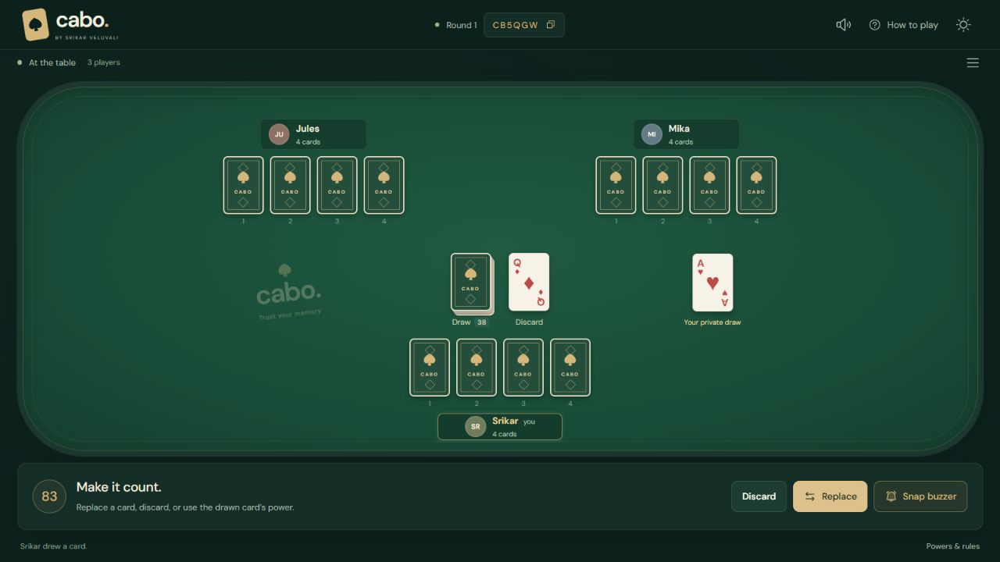
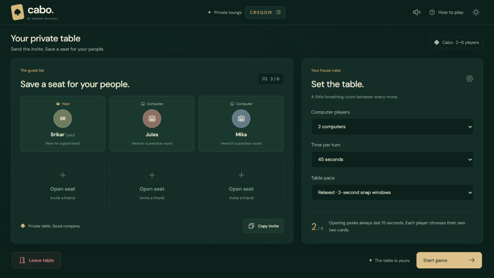
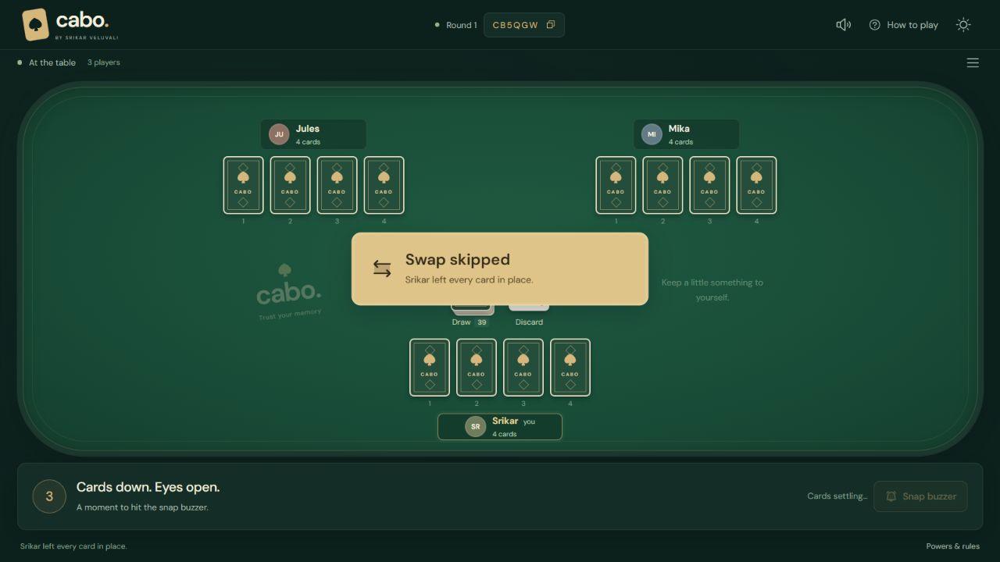
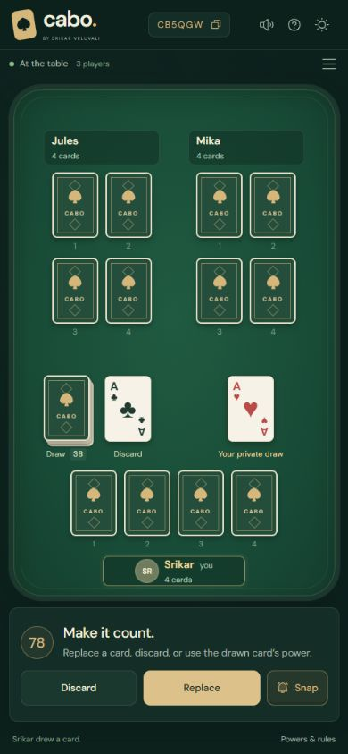
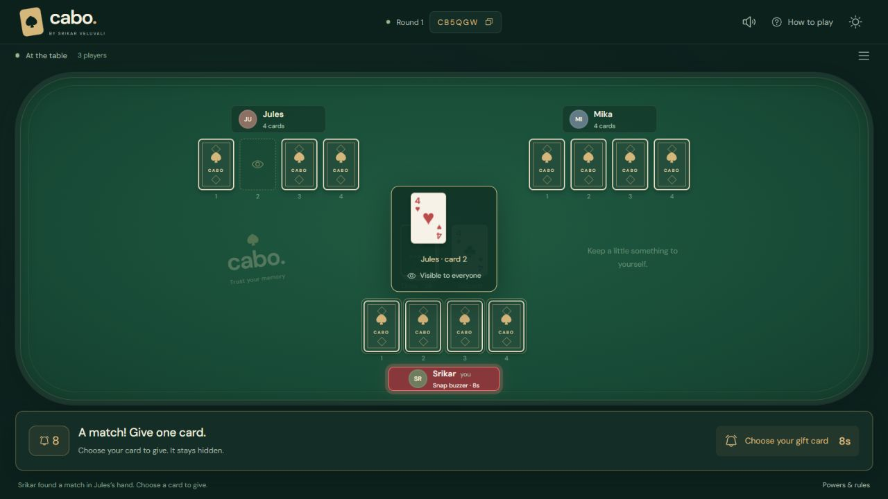

# Cabo

**Four cards. Two peeks. Trust your memory.**

A private multiplayer card game by **Srikar Veluvali**. Play with friends in the browser, or practice against computers. Built with Next.js, React, TypeScript, and Motion.

### [Play Cabo →](https://cabo-multiplayer.vercel.app/)

No accounts or downloads. Create a table and share the invite link or six-character room code.



## Bring your people

1. Open [Cabo](https://cabo-multiplayer.vercel.app/) and enter your name.
2. **Create a table**, then **Copy invite** to invite friends. Guests can also choose **Join friends** and enter the room code.
3. Choose the turn limit, table pace, and optional computer opponents. Each guest marks themselves ready; the host starts the game.
4. Pick two cards to remember, keep track of the table, and call CABO when you think you have the lowest total.

There are **2–6 seats**, including up to **three computers**. **Practice with computers** opens a table with two opponents immediately.



## At the table

- Cards visibly travel between their slots, the private peek desk, the draw deck, and the discard pile.
- Gold action notices identify plays, discards, replacements, swaps, and skipped powers.
- The snap buzzer belongs to the first player whose press reaches the server. Their nameplate pulses red while they choose.
- Hands stay centered as cards leave or penalty cards arrive. Larger hands wrap into rows.
- Dark and light themes, optional sound effects with a remembered mute setting, keyboard focus, and reduced-motion support are included.
- On small screens, player pages follow the action. Settings and the activity log remain accessible without page scrolling.





## Rules

These are the house rules implemented in this game. The **How to play** panel includes them too.

### Setup and scoring

Use one shuffled **52-card deck**, without jokers. Every player receives **four face-down cards**. After the animated deal, everyone has **15 seconds** to choose up to **two of their own cards** to look at. Chosen cards stay visible for the rest of that opening window, then return face down. Unused peeks expire.

The goal is the **lowest total**:

| Card    |     Points |
| ------- | ---------: |
| A       |          1 |
| 2–10    | Face value |
| J       |         11 |
| Q       |         12 |
| Black K |         13 |
| Red K   |         −1 |

An empty hand totals **zero**. Emptying your hand does not end the round automatically.

### Your turn

Before drawing, you may **call CABO**. Otherwise, draw one card privately from the deck and choose one of three actions:

- **Discard** the drawn card.
- **Replace** one of your face-down cards with it. The old card goes face up onto the discard pile.
- **Play its power**, discarding the drawn card as you do so.

You cannot draw from the discard pile. Only a freshly drawn card can activate a power; snapping or replacing a card does not activate its power.

### Card powers

| Drawn card | Power                                                                                |
| ---------- | ------------------------------------------------------------------------------------ |
| 7 or 8     | Look at one of your own cards.                                                       |
| 9 or 10    | Look at one opponent card.                                                           |
| J          | Optionally blind-swap any two different cards on the table.                          |
| Q          | Optionally look at one card anywhere, then optionally swap any two cards.            |
| Black K    | Optionally look at two different cards anywhere, then optionally swap any two cards. |
| Red K      | No played power. Keep it for its −1 score.                                           |

Looking and swapping are **separate choices**. With Q or black K, you can look and skip the swap, or skip looking and still swap. The cards you swap do not need to be the cards you looked at. Two cards in the same hand may be swapped.

Power peeks last up to **five seconds**. Cards move to the acting player's desk and return to their original slots. Only that player receives the card faces; everyone else sees the backs. A CABO caller's hand can be looked at, but cannot participate in a swap.

### Snap buzzer

Remember a card that matches the **rank** of the top discard? Hit **Snap buzzer**, even out of turn.

The first accepted press reserves the table for **eight seconds**. Other actions and the ordinary turn clock pause while that player chooses. Each player gets one attempt per top discard. All kings match each other, regardless of color or suit.

**Snap your own card:** a correct match moves it onto the discard pile and reduces your hand by one card.

**Snap an opponent's card:** a correct match is revealed to the table. You then have another eight seconds to choose one of your own cards to give them, face down. Their matched card goes onto the discard; your gift fills its original slot. If the gift timer expires, the game chooses one of your cards at random. You need a card in your hand to offer an opponent snap.

**An incorrect snap:** the attempted card stays with its owner and is revealed publicly for **exactly five seconds**. Only the snapper receives **one random, unseen penalty card**. Missing the initial eight-second selection window also gives a penalty card.

CABO hands are locked against opponent snaps and transfers. The caller may still snap their own cards. A stale click on a changed discard is rejected without a penalty.



### Calling CABO and winning

Call CABO **at the start of your turn, before drawing**. Calling uses that turn and locks your hand against swaps and opponent-snap transfers. Every other player gets **exactly one final turn**, followed by the last snap window. Then all hands are revealed.

- The caller wins only if their total is **strictly lower** than everyone else's.
- If the caller is tied or beaten, all **other players with the actual lowest total** win together.
- Round wins carry into rematches. The first player rotates each round.

If the **draw deck runs out before anyone calls CABO**, the last draw and any power finish, the cards settle, and the lowest total wins. Ties share the win. After CABO, older discards may be reshuffled to finish the promised final turns; the top discard stays in place. If no card is available for a required draw or penalty, the round ends with scoring.

### Pace, timeouts, and reconnecting

The host chooses a **30, 45, 60, or 90-second turn limit**. A timeout discards any held draw without activating its power and passes the turn. Cards settle before another action is accepted. Between turns, the buzzer window lasts **three seconds** in relaxed mode or **1.8 seconds** in quick mode; resolving a snap restarts it.

Refresh the same tab to reconnect to your seat. Closing it keeps the seat in the game, with turns advancing through timeouts. An active human can inherit hosting after the host has been absent for a minute. The host can start a rematch or return everyone to the lounge after scoring.

## Run locally

Use **Node.js 22** and npm:

```sh
npm ci
npm run dev
```

Open [localhost:3000](http://localhost:3000). For another human seat, use a fresh browser tab at the base URL. Duplicating an existing tab may copy its seat session. Friends on your LAN can use your machine's LAN address and port if the firewall permits it.

Without Redis credentials, one Node.js process stores room snapshots in `.data/rooms/`. For a persistent server:

```sh
npm run build
npm start
```

The server listens on `0.0.0.0:3000`; use `PORT` to change the port. The file fallback needs a persistent writable disk and does not coordinate writes across multiple processes.

## Deploy on Vercel

The live game is [cabo-multiplayer.vercel.app](https://cabo-multiplayer.vercel.app/). Its private GitHub repository is connected to Vercel; pushes to `main` deploy automatically. Functions run in **Mumbai (`bom1`)**, with shared Redis storage following the companion BlackJack game's setup.

For another installation:

1. Import the repository as a **Next.js** project. Node.js 22 and the build/install commands are configured in the repository.
2. Connect an Upstash Redis database near your function region. Configure **Production**, **Preview**, and **Development** as needed.
3. Set either `UPSTASH_REDIS_REST_URL` and `UPSTASH_REDIS_REST_TOKEN`, or `KV_REST_API_URL` and `KV_REST_API_TOKEN`. Use a **REST write token**. A raw `REDIS_URL` alone is insufficient.
4. Deploy, and redeploy after changing environment variables. Keep the production site accessible to your players.

See [.env.example](.env.example). Keep credentials server-side, without a `NEXT_PUBLIC_` prefix, and never commit `.env.local`.

Redis keys default to `cabo:<VERCEL_ENV or development>:room:`. This separates Cabo from BlackJack and separates production from preview/development. Set `ROOM_STORE_PREFIX` for additional isolation, such as separate preview branches. Rooms expire after **24 hours without game activity**; unchanged polls do not extend their lifetime. Expired local files are rejected but are not automatically removed from disk.

## How multiplayer works

The Next.js API owns the deck, randomness, legal moves, timers, powers, scoring, and card visibility. Each room is one expiring JSON snapshot. Atomic Redis compare-and-set transactions retry competing writes, so simultaneous buzzer presses cannot both claim the same table.

Visible clients poll roughly every **650 ms**, and background tabs every **three seconds**. Requests advance expired timers and computer moves; there is no separate socket server or scheduled worker. If everyone closes the game, the next request resumes processing the room. Polling consumes Redis provider requests, so monitor usage as the number of players grows.

Public snapshots exclude the deck, seat credentials, computer memories, and hidden card faces. Card IDs are random UUIDs. Seat credentials live in browser session storage. Private draws and peeks are sent only to the authorized seat. As with a physical memory game, a player can record cards they were legitimately shown.

Computers use their opening memories, their own draws, public reveals, and powers they have played. They do not read hidden opponent cards to choose moves. This is a casual private-room game, without accounts or public matchmaking.

## Development checks

```sh
npm test
npm run typecheck
npm run format:check
npm run build

# With the app running in another terminal:
npm run test:integration
```

Set `TEST_URL` to test another origin, including the deployed game. The multiplayer smoke test creates two temporary sessions, verifies private peeks/draws, races buzzers, attempts an opponent snap, replaces a card, calls CABO, checks scoring, and leaves both seats.

Tests cover rules, optional powers, scoring ties, hand protection, penalties, the five-second reveal, deck exhaustion, timeouts, computer rounds, and concurrent room writes. GitHub Actions runs the checks and the production API smoke test on pushes and pull requests. Browser checks cover card flights, animation handoffs, action notices, reveal colors, and responsive layouts.

## Project map

| Path                                                    | Responsibility                                      |
| ------------------------------------------------------- | --------------------------------------------------- |
| `app/api/rooms/route.ts`                                | Authenticated room reads, joins, and actions        |
| `lib/game.ts`                                           | Game rules, timers, scoring, and computer decisions |
| `lib/store.ts` / `lib/storage/`                         | Room transactions and Redis/file storage            |
| `components/table.tsx`                                  | Hands, controls, peeks, and public reveals          |
| `components/card-motion.tsx` / `replacement-motion.tsx` | Explicit card flights and replacements              |
| `components/table-action.tsx`                           | Gold action notices                                 |
| `components/use-table-sounds.ts`                        | Locally synthesized sound effects and mute control  |
| `tests/` / `scripts/smoke.mjs`                          | Rules, storage, and multiplayer checks              |

Fonts are self-hosted **DM Sans**, under the [SIL Open Font License](public/fonts/OFL.txt). Sounds are generated locally with Web Audio. Source code is proprietary (`UNLICENSED`).
