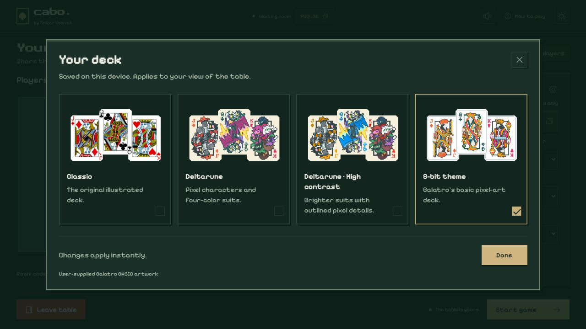
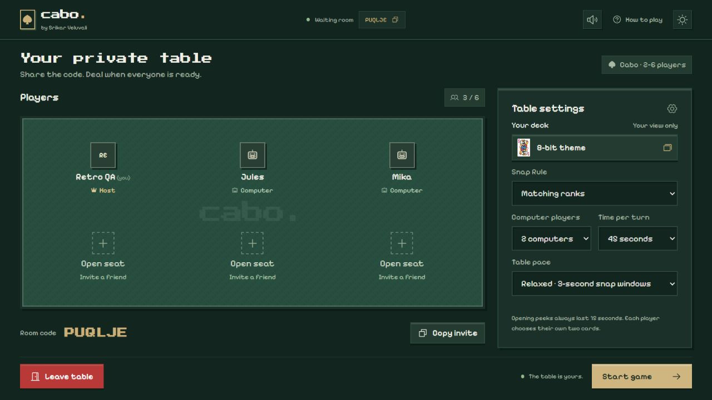
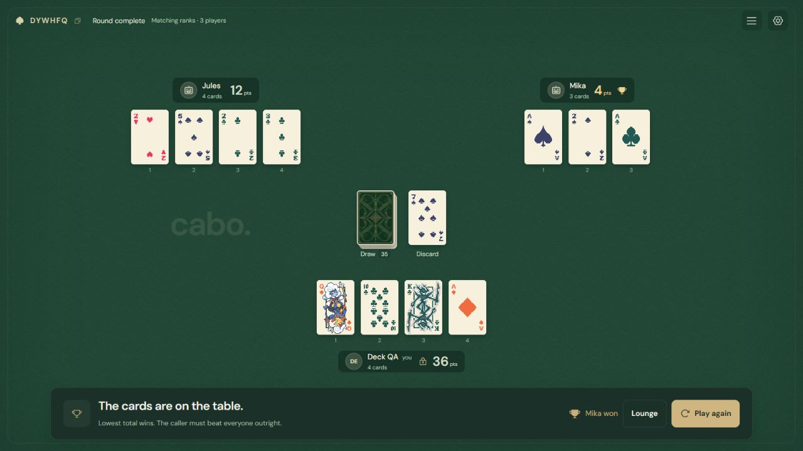
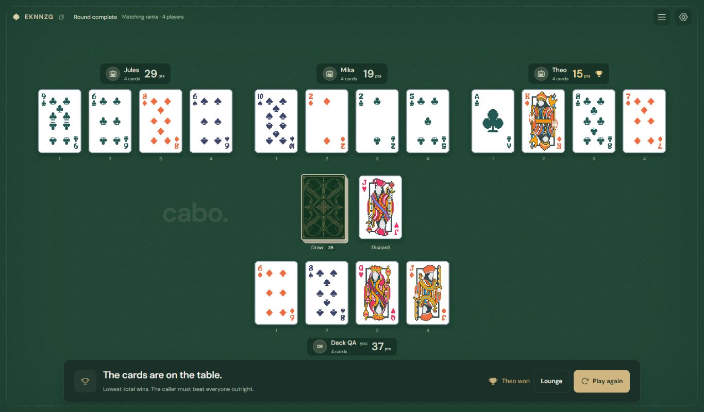

# Custom card themes

In the waiting room, open **Table settings → Your deck**. On phones, first switch to the **Table settings** tab. The control is available to every player, including guests whose room-rule controls are disabled. **Table options → Customize deck** also remains available during play. Choosing a theme applies immediately and is saved on that device. Each player sees their chosen artwork across the whole table, private peeks, public reveals, animations, and rules examples. It is a cosmetic preference: ranks, suits, scores, hidden information, and multiplayer rules are unchanged.

The included choices are **Classic**, **Deltarune**, **Deltarune · High contrast**, and **8-bit theme**. New players start with the 8-bit theme; existing saved choices are preserved. The Deltarune images were copied from the supplied Balatro mod asset pack, with their original filenames and both resolutions preserved. That pack contains transparent face overlays, so the theme supplies an ivory card background. The 8-bit theme uses all 52 original Balatro BASIC PNGs, copied byte-for-byte with their original names, white faces, pixel borders, colors, and transparency. All included decks use the shared pixel sleeve. No mod code or Balatro installation is needed.

Every deck has the same stepped pixel corners, including future custom JPEG or atlas themes. A shared CSS mask clips the card faces and backs, preview cards, and animation cards; it never modifies the supplied image files. Card dimensions and travel coordinates remain unchanged.





Suit colors are part of the artwork. King scoring still follows the suit: hearts/diamonds count as −1, and clubs/spades count as 13.





## Add a sprite-sheet theme

1. Put your image in `public/cards/themes/<theme-name>/`. JPEG, PNG, and WebP work. Use PNG/WebP when transparency is needed.
2. Add an entry to the `themes` array in `config/deck-themes.json`.
3. Run `npm run check:decks`. The theme appears automatically in the selector; no React edits or image slicing are required. Rebuild/redeploy to make it available on the hosted site.

Example: `public/cards/themes/my-deck/cards.jpg` with 13 equal columns and four equal rows:

```json
{
  "id": "my-deck",
  "name": "My deck",
  "description": "A short description for the selector.",
  "credit": "Artist or source credit",
  "background": "#ffffff",
  "pixelated": false,
  "face": {
    "type": "atlas",
    "image": "/cards/themes/my-deck/cards.jpg",
    "columns": ["2", "3", "4", "5", "6", "7", "8", "9", "10", "J", "Q", "K", "A"],
    "rows": ["hearts", "clubs", "diamonds", "spades"]
  }
}
```

Use a unique lowercase `id`. The display `name` can contain spaces. Asset URLs start at `/cards/…`, without `public`.

### Grid layout

The `columns` list gives ranks from **left to right**. The `rows` list gives suits from **top to bottom**. These lists describe your image, so change their order to match a different sheet. The renderer divides the entire image into that many equally sized cells. There must be **no gutters, padding, or extra unused rows/columns**. Include the entire card face artwork within each cell.

The supplied 2× Deltarune sheets are **1846×760 pixels**: 13 columns × 4 rows, giving **142×190 pixels per card**. Their order is 2 through Ace, with hearts, clubs, diamonds, and spades down the rows. The 1× copies use 71×95 cells. This matches the rank order and base cell size in the official [Steamodded deck-skin template](https://github.com/Steamodded/examples/blob/master/Mods/DeckSkinTemplate/DeckSkinTemplate.lua).

Only the selected image is used at runtime; `2x` and `1x` are source-pack conventions, not required folder names. Higher-resolution sheets use the same config grid. `pixelated: true` keeps pixel art crisp. Use `false` or omit it for painted or photographic artwork.

Transparent overlays can use a `background` color, expressed as a six-digit hex code. Use `"background": "transparent"` to preserve a complete card image's transparent edges, as the 8-bit theme does. A JPEG already contains its background. Omitting `background` uses white. Frames use Cabo's existing card dimensions so all themes keep the same hand layout and animation geometry.

### Court-card-only packs

A 3×4 sheet can replace just the face cards:

```json
"face": {
  "type": "atlas",
  "image": "/cards/themes/my-deck/courts.png",
  "columns": ["J", "Q", "K"],
  "rows": ["hearts", "clubs", "diamonds", "spades"]
}
```

Any rank or suit absent from the sheet falls back to Classic artwork. A one-suit sheet is also supported by providing just that suit in `rows`. Each mapping must be unique.

### Alternate palettes and card backs

Register a high-contrast sheet as a separate theme with its own ID and image path, as the included Deltarune entries do. Every catalog entry gets its own selector option.

To supply a sleeve, add this optional property beside `face`:

```json
"back": "/cards/themes/my-deck/back.png"
```

Omit it to use the default theme's sleeve. Card backs also remain a personal visual preference, so they never identify another player's hidden cards.

## Separate card images

If a pack contains individual images instead of a sheet, use a filename template:

```json
"face": {
  "type": "files",
  "template": "/cards/themes/my-deck/{rank}_of_{suit}.jpg",
  "rankNames": { "A": "ace", "J": "jack", "Q": "queen", "K": "king" }
}
```

The renderer substitutes `{rank}` and `{suit}`. `rankNames` is optional; without it, rank filenames use `A`, `2`…`10`, `J`, `Q`, and `K`. Suits use lowercase `hearts`, `clubs`, `diamonds`, and `spades`. File-based decks must include all 52 images.

`{court}` is an optional filename token. Its value is `courtSuffix` for J/Q/K and empty for other ranks. Classic uses this to select the supplied illustrated `2.webp` variants.

### Numbered files, without renaming

Numbered sets also work directly. The BASIC pack's `8BitDeck1.png` through `8BitDeck52.png` are registered like this:

```json
"face": {
  "type": "files",
  "template": "/cards/themes/8-bit/8BitDeck{index}.png",
  "rankOrder": ["2", "3", "4", "5", "6", "7", "8", "9", "10", "J", "Q", "K", "A"],
  "suitOrder": ["hearts", "clubs", "diamonds", "spades"],
  "startIndex": 1
}
```

The rank changes first, then the suit: files 1–13 are hearts, 14–26 clubs, 27–39 diamonds, and 40–52 spades. Both order lists must contain every rank/suit exactly once. Set `startIndex: 0` for a set numbered from zero. This also works with numbered JPEG or WebP files.

The 8-bit theme has `"preload": false` so the browser loads its original full-resolution images as needed, rather than decoding all 52 at once. Omit this setting for normal deck preloading. No files are resized or re-encoded.

## Defaults and validation

Change the catalog's `defaultTheme` ID to choose the initial theme for new players. Existing saved choices are preserved. If a saved theme is removed or renamed, the player falls back to the configured default. The browser storage key is `cabo-deck-theme`, separate from the light/dark interface preference.

`npm run check:decks` checks registry entries, every referenced image, and integer atlas-cell boundaries. `npm run build` runs it automatically before compiling. Unit tests cover the supplied mappings, fallback cards, unknown saved themes, and invalid config.

Keep an artist's credit in the theme's `credit` field and retain any accompanying attribution/license files when importing future packs. The supplied asset directory contained the four PNGs and no accompanying attribution file.

## Implementation

- `config/deck-themes.json`: the only catalog to edit when adding themes.
- `lib/deck-themes.ts`: config validation, card mapping, back selection, and preload URLs.
- `components/deck-theme.tsx`: local preference and cross-tab synchronization.
- `components/card-artwork.tsx`: memoized individual-image or CSS-atlas rendering.
- `components/deck-picker.tsx`: automatic theme previews and selector.
- `lib/check-deck-assets.ts`: build-time filesystem/image checks; excluded from client rendering.

Atlas cards reuse one image rather than downloading 52 copies. Artwork is swapped inside the existing card faces, keeping stable flight and flip components. Theme selection does not modify the room schema or server snapshots.
